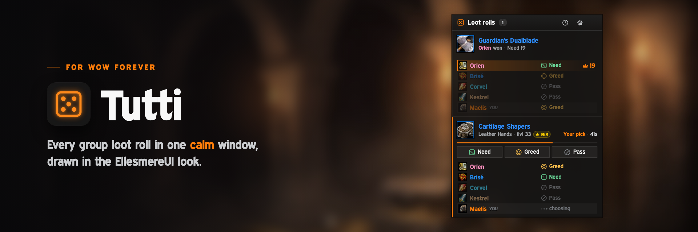

# Tutti

<!-- HERO: put  here once that image exists -->

**Every group loot roll in one calm window, drawn in the EllesmereUI look.**
When an item drops in your group, Tutti opens by itself and shows who picked Need, Greed or
Pass, everyone's roll and who won. You roll in the same window. Made for WoW Forever. In
music, *tutti* is the passage where the whole orchestra plays together; here it is the
whole group's rolls in one window.

## What it does

- **Opens by itself.** When a group roll starts, every item gets a card: the icon with its
  quality edge, the name in its quality colour, the item's type and level ("Two-Hand Axe ·
  ilvl 33"), the seconds left and a countdown bar. The whole group is listed under it, in
  the order of the party frames.
- **Everyone's pick.** Class icon, name in the class colour, then the pick: Need (a green
  die), Greed (an amber coin), Transmog (purple) or Pass (grey, and the row dims), or three
  pulsing dots while someone is still choosing. The roll number spins in when it arrives.
- **Roll right there.** A card that waits on you has an accent edge and buttons for Need,
  Greed and Pass (Transmog in place of Greed when the game offers it). If you can't Need an
  item, that button is greyed out with the game's reason. Your pick shows in your row at
  once, and the close button stays hidden while a card waits on you, so no roll is missed.
  Soulbound items still get Blizzard's own confirmation: Tutti never confirms for you.
- **A clear winner.** The winner's row lights up in the accent colour and gets a crown, its
  number turns accent-coloured and the other rows fade back. The subtitle reads "Name won ·
  Need 19". When you win, the item icon glows, a light sweeps the card and a soft chime
  plays (unless you turn it off). If everyone passed, the card says so; a tie shows both
  numbers.
- **Tidies itself up.** A decided card stays whole for about 4 seconds, then folds into one
  line under "Done" while other cards are still open. About 10 seconds after the last roll
  is decided the window closes itself. It waits while the mouse is over it, and a new roll
  cancels the countdown.
- **Recent rolls.** The session's results (up to 100), grouped by instance or zone and day,
  one click away: the clock in the window's header, the addon compartment (the minimap's
  addon menu) or `/tutti`. Click a line to see everyone's picks. They survive `/reload` and
  are cleared at login.
- **Raids too.** In a raid a card lists only the members who picked Need, Greed or
  Transmog, the winner, and you. Everyone else folds into one line ("13 passed · 2
  choosing") that opens. A long list of cards scrolls inside the window once it would pass
  about 70 % of the screen's height.
- **Items as usual.** On a card, hover the icon or the name for the item tooltip,
  shift-click to link it in chat, ctrl-click for the dressing room. With NaowhForever_BiS,
  its BiS badge shows on a card for an item it ranks for you.
- **Matches your UI.** With EllesmereUI it follows your panel colour and font live, and the
  accent is your class colour or EllesmereUI's. Without EllesmereUI it uses the same palette
  and the game font, with your class colour.

## Commands

| | |
|---|---|
| `/tutti` | open or close Recent rolls |
| `/tutti settings` | open the settings |
| `/tutti demo` | play a boss drop with no real rolls, to see the window at work (with your group's names when you are in one) |

The clock in the window's header and the addon compartment open Recent rolls too. Drag the
header to move the window; its position is saved. There is no minimap button.

## Settings

The gear in the window's header. Changes apply at once.

Roll in Tutti (Need, Greed and Pass on each card, Blizzard's roll popups hidden) · close
after the last roll (5, 10, 20 or 30 seconds, or never) · sound when you win (soft chime or
none) · accent (class colour or EllesmereUI's, with EllesmereUI) · size (80 to 130 %).

Turning "Roll in Tutti" on takes effect at once. Turning it off brings Blizzard's popups
back after a `/reload`; the setting says so and offers a Reload button.

## Compatibility

WoW Forever (1.60.1, Interface 16001). For now Tutti runs on WoW Forever only. EllesmereUI,
NaowhForever_BiS and Polestar are optional.

## Good to know

- **Blizzard's roll popups are replaced.** While "Roll in Tutti" is on, Tutti switches them
  off (the way ElvUI does). After a `/reload` in the middle of a roll, Blizzard's popups for
  the rolls still open show up next to Tutti's cards, once.
- **Gamepad interface.** With the gamepad interface on, Blizzard's own gamepad roll frame
  still shows next to Tutti's window: Tutti does not hide Blizzard's frames.
- **EllesmereUI is optional.** With the popups hidden, EllesmereUI's loot-roll skin and its
  "Group Loot" mover have nothing to act on, which is harmless.
- **Polestar.** Its note about a quest item a party member still needs sits under Tutti's
  window while both show.
- **Group loot only.** With free-for-all, master loot or personal loot nothing opens. A
  roll you are not part of still gets a card, without buttons, and a member who is out of
  range or dead shows "not in this roll".

## Development

The addon is plain Lua with no libraries. An offline suite runs it inside a fake WoW Forever
client:

```sh
luajit tests/run.lua && luajit tests/syntax.lua
python3 -I tests/test_media.py   # needs Pillow
```

Media is generated: `python3 -I tools/make_media.py .` (Pillow) and
`python3 -I tools/make_sound.py .` (ffmpeg). `luajit tools/render_ui.lua` draws the window
from the fake client as a web page, to check the look without the game. The design is in
[docs/design.md](docs/design.md). Releases: see [docs/RELEASING.md](docs/RELEASING.md). When
Forever is patched, its new interface number goes into `## Interface` in `Tutti.toc`.

## License

MIT © creazy231
