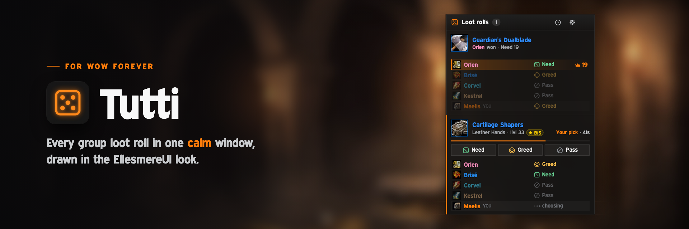
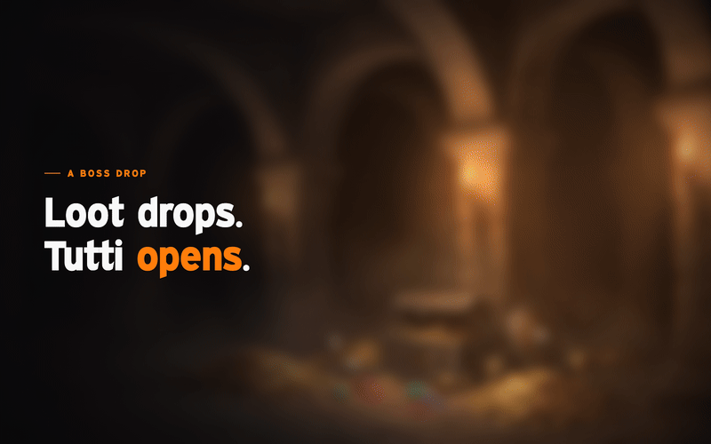
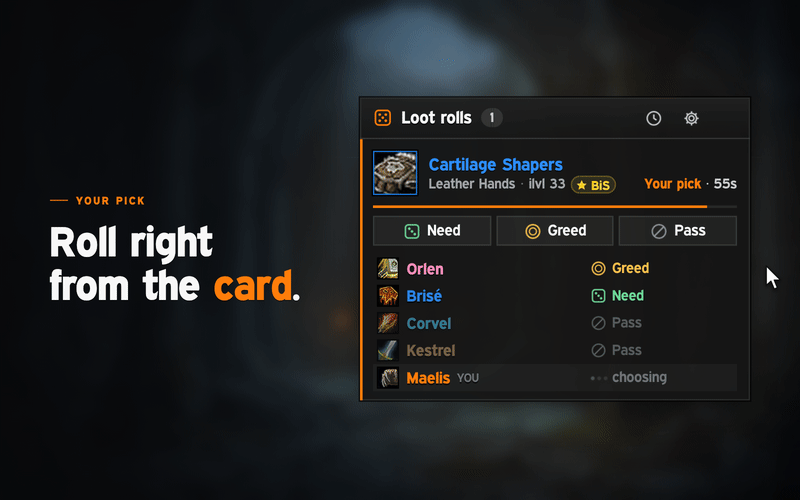
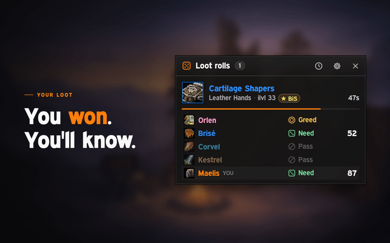

# CurseForge listing for Tutti

Everything to paste into the CurseForge project form (authors.curseforge.com).

## Basics

- **Project name:** Tutti
- **Game / class:** World of Warcraft · Addons
- **Game version:** WoW Forever (the packager sets it on every upload from `## Interface: 16001`
  in `Tutti.toc`)
- **Primary category:** Bags & Inventory. CurseForge has no loot category; this is where its
  group loot roll addons are filed (Better Loot Rolls, Blocky Loot Frame, Should I Roll?).
  Second choice, as an additional category: Miscellaneous.
- **License:** MIT License
- **Source:** https://github.com/creazy231/Tutti
- **Issues:** https://github.com/creazy231/Tutti/issues
- **Avatar:** `docs/listing/icon.png` (400 × 400; `icon-source.jpg` is the 2048 px original)
- **Summary** (136 characters):

  > Every group loot roll in one window: who picked Need, Greed or Pass, the rolls and the winner. In the EllesmereUI look, for WoW Forever.

## Screenshots (gallery, in this order, with these captions)

1. `screenshots/01-every-roll.png`: Every roll, in one window: each item gets a card, with your whole group under it.
2. `screenshots/02-picks.png`: Who picked what, at a glance: Need, Greed, Pass or still choosing, right next to every name.
3. `screenshots/03-winner.png`: Every number, one winner: the numbers spin in, the winner gets a crown.
4. `screenshots/04-you-won.png`: When you win, it glows: a light sweeps the card and a soft chime plays.
5. `screenshots/05-recent.png`: The whole run, one click away: every result of the session, with everyone's picks.
6. `screenshots/06-settings.png`: Looks like your UI: EllesmereUI's colours and font, or your class colour.
7. `animations/01-a-boss-drop.gif`: A boss drop from start to finish: the picks come in, the numbers spin, the winners get their crowns and the window tidies itself away.
8. `animations/02-roll-from-the-window.gif`: Roll right from the card: one click, and your pick is in.
9. `animations/03-you-won.gif`: You won. You'll know: the crown, the glow and a sweep of light.

7 to 9 only if the gallery takes GIFs; the description plays them anyway.

The images carry their headline. `python3 -I tools/make_listing.py <render-dir>` renders the
screenshots again from the addon's real UI and `python3 -I tools/make_gifs.py <render-dir>` the
animations (copy and layout in their `SHOTS` and `GIFS` lists, the render dir as in CLAUDE.md).

## Description (Markdown)

```markdown


**Every group loot roll in one calm window, drawn in the EllesmereUI look.**
When an item drops in your group, Tutti opens by itself and shows who picked Need, Greed or Pass, everyone's roll and who won. You roll right there too. Made for WoW Forever.



## Features

- **Opens by itself.** When a group roll starts, every item gets a card: icon, name, item type and level, and the seconds left. Your whole group is listed under it, in party order.
- **Everyone's pick.** Need, Greed, Transmog or Pass, each with an icon and a word, or three dots while someone is still choosing. Roll numbers spin in as they arrive.
- **Roll right there.** Cards that wait on you have Need, Greed and Pass buttons (Transmog in place of Greed when the game offers it), and Blizzard's roll popups stay hidden. If you can't Need an item, the button is greyed out with the game's reason.



- **A clear winner.** The winner's row lights up and gets a crown; the other rows fade back. When you win, the item icon glows, a light sweeps the card and a soft chime plays.



- **Tidies itself up.** A decided item folds into one line while others are still open, and the window closes itself after the last roll (10 seconds by default). With the mouse over it, it waits.
- **Recent rolls.** The session's results, grouped by place and day, one click away. Click a line to see everyone's pick. Kept through /reload, cleared at login.
- **Raids too.** In a raid a card lists only who picked Need, Greed or Transmog, plus you. Everyone else folds into one line you can open.
- **Items as usual.** Hover for the tooltip, shift-click to link, ctrl-click for the dressing room.
- **Matches your UI.** With EllesmereUI it follows your panel colour and font live; the accent is your class colour or EllesmereUI's. Works without EllesmereUI too.
- **BiS badges.** With NaowhForever_BiS, its BiS badge shows on the cards of items it ranks for you.

## Settings

The gear in the window's header: Roll in Tutti · close after the last roll (5, 10, 20 or 30 seconds, or never) · sound when you win (soft chime or none) · accent (class colour or EllesmereUI's, with EllesmereUI) · size (80 to 130 %). Changes apply at once.

## Commands

- `/tutti` open or close Recent rolls
- `/tutti settings` settings
- `/tutti demo` play a boss drop to see the window at work, without real rolls (with your group's names when you're in one)

The clock in the window's header and the addon compartment (the addon menu on the minimap) open Recent rolls too. Drag the header to move the window.

## Good to know

- **Made for WoW Forever.** For now Tutti runs on WoW Forever only.
- **Blizzard's roll popups** are replaced while "Roll in Tutti" is on. Turning it off brings them back after a /reload; the setting offers a Reload button.
- **Gamepad interface:** with it on, Blizzard's gamepad roll frame still shows next to Tutti.
- **Soulbound items** still ask Blizzard's own confirmation. Tutti never confirms for you.
- **Group loot only:** with free-for-all, master or personal loot, nothing opens.
```

The hero image and the three animations load from GitHub through their raw URLs, so they show
once the repository (github.com/creazy231/Tutti) is public and its `main` branch holds
`docs/listing/`. Each GIF is under 1.5 MB.
